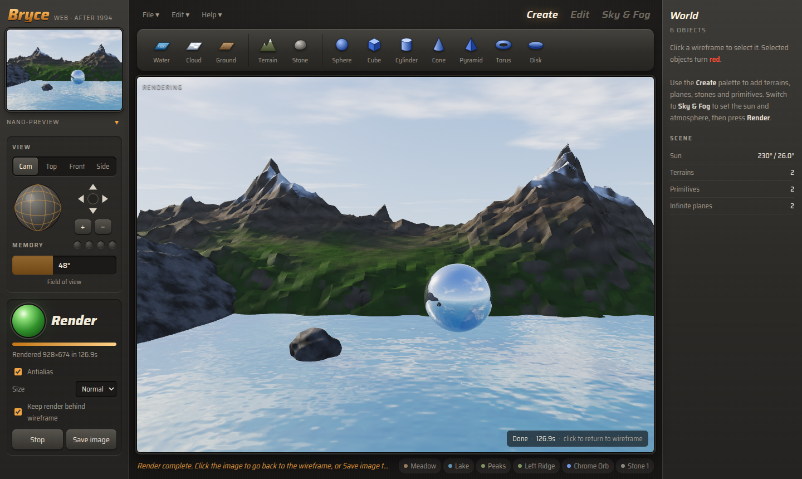
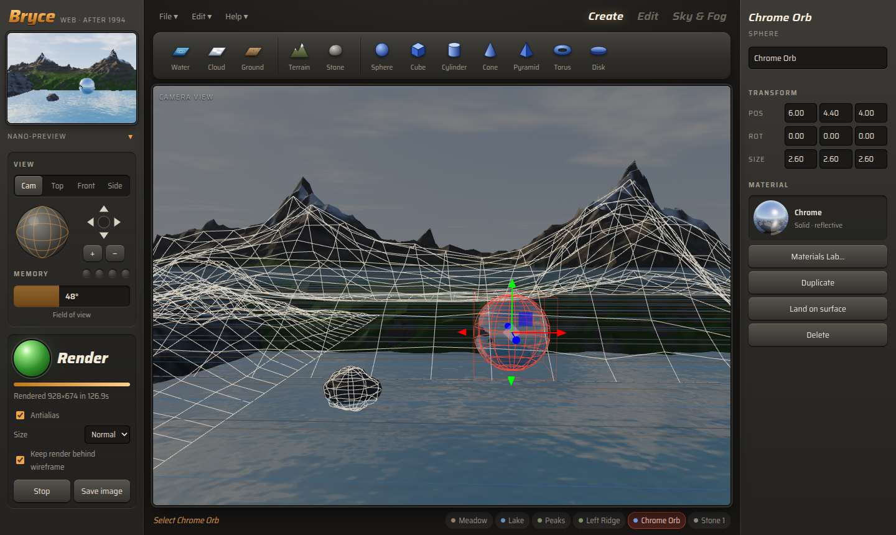
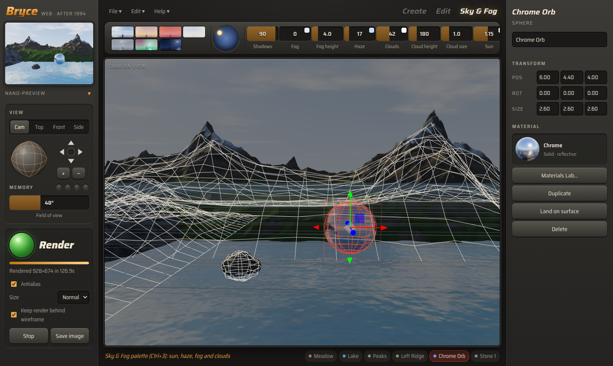
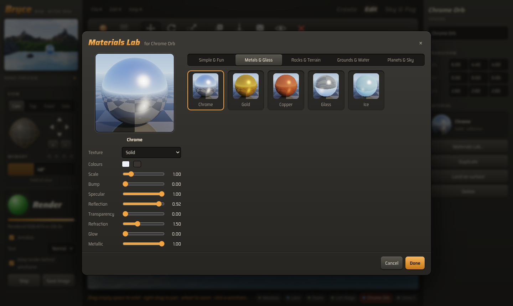
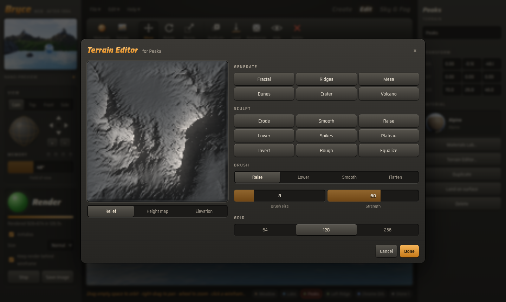
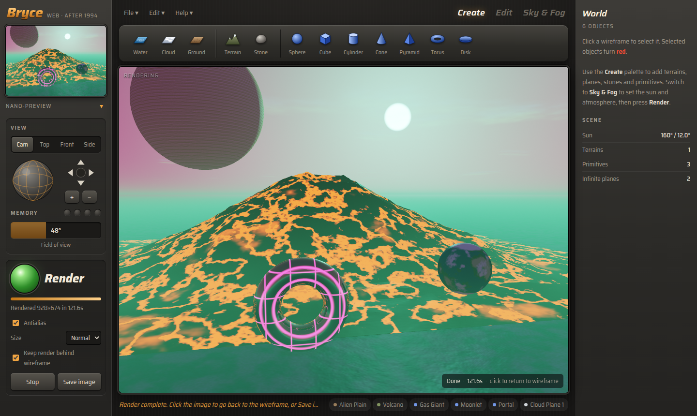
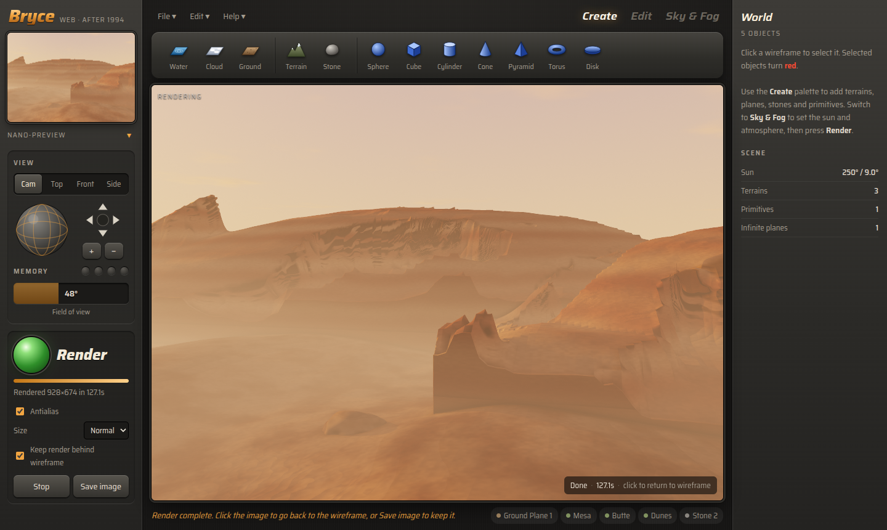

# Bryce Web

A browser-based landscape studio inspired by **KPT Bryce** (1994), the program that let anyone build surreal mountain worlds, chrome spheres and glowing skies — then watch them ray-trace line by line.

Bryce Web brings that workflow to the web: build a scene in a wireframe working window, dress it in materials, set the sun and atmosphere, then hit the big green **Render** orb and watch a GPU ray tracer sharpen the image pass by pass.

**Try it live:** [divebombdom.github.io/bryce-web](https://divebombdom.github.io/bryce-web/) · mirror at [bryce1994-web.pplx.app](https://bryce1994-web.pplx.app)



## Screenshots

| Wireframe working window | Sky & Fog over a kept render |
| --- | --- |
|  |  |

| Materials Lab | Terrain Editor |
| --- | --- |
|  |  |

| Alien World example | Desert Mesa example |
| --- | --- |
|  |  |

## Features

- **Classic Bryce layout** — Nano-Preview, camera trackball and cross pad, four camera memory dots, field-of-view scrub, and the green Render orb.
- **Create palette** — water, cloud and ground planes, fractal terrains, stones, and primitives (sphere, cube, cylinder, cone, pyramid, torus, disk).
- **Edit palette** — move / rotate / resize gizmo, duplicate, land on surface, randomize, hide, delete.
- **Materials Lab** — ~30 presets across Simple & Fun, Metals & Glass, Rocks & Terrain, Grounds & Water, Planets & Sky, each with live ray-traced previews and editable parameters (bump, reflection, transparency, refraction, glow, metallic).
- **Terrain Editor** — generators (fractal, ridges, mesa, dunes, crater, volcano), sculpt operations (erode, smooth, spikes, plateau, invert, equalize…), a paint brush, and 64/128/256 grids.
- **Sky & Fog** — seven sky presets, a draggable sun ball, haze, height fog, cloud layers and shadow strength.
- **Progressive GPU ray tracer** — signed-distance primitives, heightfield terrains, soft shadows, ambient occlusion, reflection and refraction, procedural textures, antialiasing.
- **Workflow** — example scenes, undo/redo, save/open scenes as JSON, export renders as PNG, keyboard shortcuts.

## Shortcuts

| Key | Action |
| --- | --- |
| `Ctrl+R` / `Enter` | Render |
| `W` / `E` / `R` | Move / Rotate / Resize |
| `Ctrl+D` | Duplicate |
| `Delete` | Delete selected |
| `Ctrl+Z` / `Ctrl+Shift+Z` | Undo / Redo |
| `Ctrl+1` / `2` / `3` | Create / Edit / Sky & Fog palette |
| `Esc` | Deselect / close dialogs |

## Run locally

No build step — it is plain HTML, CSS and ES modules (Three.js loads from a CDN).

```bash
git clone https://github.com/divebombdom/bryce-web.git
cd bryce-web
python3 -m http.server 8000
# open http://localhost:8000
```

A browser with WebGL 2 is required. A dedicated GPU makes full-quality renders much faster.

## Project layout

```
index.html        UI layout
css/style.css     Kai's Power Tools–style interface
js/main.js        app state, palettes, dialogs, render loop
js/editor.js      Three.js wireframe working window
js/raytracer.js   progressive render passes
js/shader.js      generated GLSL ray-marching shader
js/scene.js       materials, skies, object types, example scenes
js/terrain.js     heightmap generators and sculpting
js/icons.js       palette icons
```

## Credits

An homage to KPT Bryce by Kai Krause, Eric Wenger and the MetaTools team. Not affiliated with or endorsed by the owners of Bryce.
